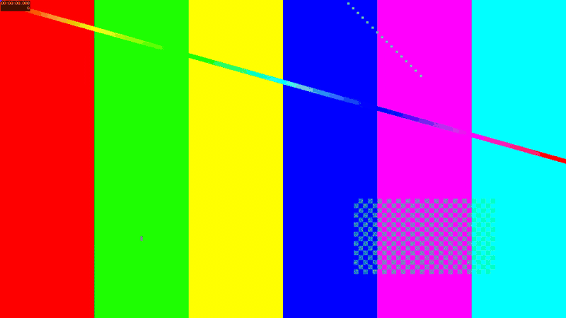
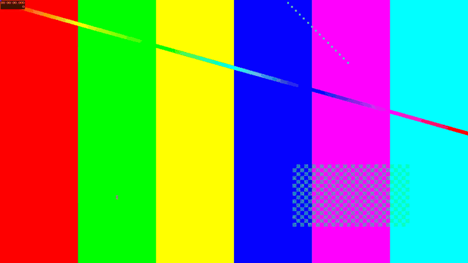
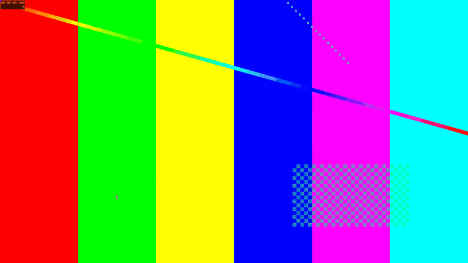
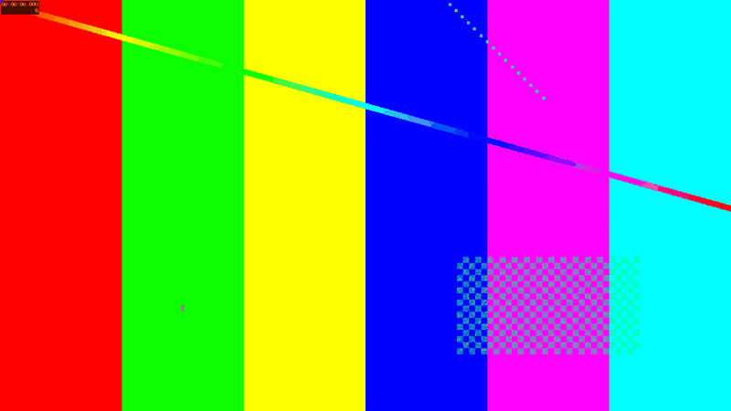

# video-cutlist

[](https://www.gnu.org/software/bash/)
[](https://ffmpeg.org/)
[](https://jqlang.github.io/jq/)
[](tests/run-tests.sh)
[](cutlist)
[](LICENSE)

`video-cutlist` is a declarative, zero-dependency video assembly compiler written in Bash. It parses a structured JSON edit specification and generates optimized, fully resolved FFmpeg command pipelines without encoding media directly. By inspecting stream parameters and GOP structure across input clips, it dynamically chooses between lossless stream copying, keyframe-aligned hybrid re-encoding, or full filtergraph crossfading.

---

## Features

- **Declarative JSON Spec**: Define clip sequences, hard cuts, and transition effects in an intuitive JSON manifest.
- **58 Native Transitions**: Full support for all 58 FFmpeg `xfade` visual transitions paired with synchronized `acrossfade` audio transitions.
- **Clip Metadata Caching**: Automatically caches `ffprobe` stream metadata and GOP keyframe packet indices per unique file path, accelerating compile times when clips repeat within a sequence.
- **Three Intelligent Assembly Modes**:
  - **Stream Copy (`-c copy`)**: Instantly joins matching clips with zero generation loss when all joins are cuts.
  - **Hybrid Re-encoding**: Slices video at exact keyframe boundaries, re-encoding only the transition overlap frames while losslessly copying static segments via MPEG-TS intermediates.
  - **Full Re-encoding**: Automatically normalizes mixed resolutions via letterboxing/pillarboxing, aligns frame rates, and synthesizes audio tracks for silent clips.
- **Pre-flight Error Diagnostics**: Comprehensive validation catches missing files, unreadable containers, invalid durations, sequence syntax errors, and provides typo corrections using Levenshtein distance matching.
- **Safe Atomic Output**: Renders into a temporary file (`<stem>-p.<ext>`) and atomically promotes it to the target path only on zero exit status.
- **Pure Shell Architecture**: Zero Python or runtime package dependencies, executing directly with `bash`, `jq`, and `ffmpeg`.

---

## Tech Stack

- **Core Runtime**: Bash 4+
- **Media Engine**: FFmpeg / FFprobe (utilizing `xfade`, `acrossfade`, `segment` muxer, and `concat` demuxer)
- **Data Parsing**: jq
- **Video Codecs**: libx265 (HEVC), libx264 (AVC)
- **Audio Codec**: AAC (48 kHz stereo normalized)
- **Testing Framework**: Custom Bash test harness with `ffprobe` stream verification and `framemd5` frame-level identity checks

---

## Installation

### Prerequisites

Ensure `bash`, `jq`, and `ffmpeg` (with `ffprobe`) are installed on your system.

**macOS (Homebrew)**
```sh
brew install jq ffmpeg
```

**Linux (Debian/Ubuntu)**
```sh
sudo apt-get update && sudo apt-get install -y jq ffmpeg
```

### Setup

Clone the repository and verify execution permissions:

```sh
git clone https://github.com/unamatasanatarai/video-cutlist.git
cd video-cutlist
chmod +x cutlist tests/run-tests.sh examples/mp4-to-gif.sh
```

---

## Usage

`cutlist` reads your specification file and emits the exact command string to `stdout`, while routing progress inspection, stream metadata, and diagnostic plans to `stderr`.

### Basic Execution Flow

```sh
# Print the generated FFmpeg command and display the execution plan
./cutlist spec.json

# Pipe directly into bash to execute the render
./cutlist spec.json | bash

# Save the generated command to an executable script
./cutlist spec.json > render.sh
chmod +x render.sh && ./render.sh
```

### Inspecting Transitions and Help

```sh
# List all 58 supported transition names with descriptions
./cutlist --list

# Show command-line usage and specification options
./cutlist --help
```

---

## Configuration

A cutlist specification is a standard JSON file. Only the `sequence` array is required. All other keys provide defaults.

### Minimal Example

```json
{
  "output": "final.mp4",
  "sequence": ["intro.mp4", "fade", "scene1.mp4", "scene2.mp4", "wipeleft:0.5", "outro.mov"]
}
```

### Full Configuration Reference

```json
{
  "sequence": ["clips/a.mp4", "fade", "clips/b.mp4", "clips/c.mp4", "wipeleft:0.5", "clips/d.mp4"],
  "output": "holiday.mp4",
  "duration": 0.75,
  "size": "1920x1080",
  "fps": 30,
  "audio": true,
  "codec": "libx265",
  "crf": 23,
  "preset": "slow",
  "audio_bitrate": "128k"
}
```

### Configuration Options

| Key | Type | Default | Description |
| :--- | :--- | :--- | :--- |
| `sequence` | `array` | *(required)* | Ordered list of clip paths and transition tokens |
| `output` | `string` | `"combined-video.mp4"` | Target output filename (resolved relative to spec path) |
| `duration` | `number` | `1` | Default transition duration in seconds (must be > 0) |
| `size` | `string` / `array` | First clip resolution | Frame dimensions (e.g., `"1920x1080"` or `[1920, 1080]`) |
| `fps` | `number` / `string` | First clip frame rate | Frames per second (e.g., `30`, `29.97`, `"30000/1001"`) |
| `audio` | `boolean` | `true` | Retain audio tracks (`false` strips audio completely) |
| `codec` | `string` | `"libx265"` | Compression format (`"libx265"` or `"libx264"`) |
| `crf` | `number` | `23` | Constant Rate Factor (lower yields higher visual quality) |
| `preset` | `string` | `"slow"` | Encoder preset (`"ultrafast"`, `"fast"`, `"medium"`, `"slow"`, `"veryslow"`) |
| `audio_bitrate`| `string` | `"128k"` | AAC audio bitrate (e.g., `"96k"`, `"128k"`, `"192k"`, `"256k"`) |

### Sequence Syntax Rules

- **Hard Cuts**: Two adjacent clip paths in sequence are joined with a direct cut:
  ```json
  "sequence": ["clip1.mp4", "clip2.mp4"]
  ```
- **Transitions**: A valid transition name placed between two clips blends them:
  ```json
  "sequence": ["clip1.mp4", "fade", "clip2.mp4"]
  ```
- **Per-Transition Duration**: Override the default duration by appending `:SECONDS`:
  ```json
  "sequence": ["clip1.mp4", "dissolve:2.5", "clip2.mp4"]
  ```
- **File Collisions**: If an input file shares a name with a transition keyword, prefix it with a directory separator (e.g., `"./fade"`).

---

## Assembly Methods

Before printing, `cutlist` examines clip streams using `ffprobe` and picks the most efficient rendering path:

1. **Stream Copy**: Selected when every transition is a hard cut and all source clips share identical video codec, profile, resolution, SAR, pixel format, frame rate, timebase, and audio configuration. Compiles a near-instant `-c copy` concat demuxer pipeline.
2. **Hybrid Copy & Re-encode**: Selected when video streams share identical H.264 or H.265 encoding parameters and closed GOPs. It copies intermediate static frames unchanged using FFmpeg segment muxing, only decoding and blending frames within transition boundaries.
3. **Full Filtergraph Re-encode**: Normalizes clips with differing frame rates, color spaces, or aspect ratios. Automatically adds letterboxing/pillarboxing with black padding and pads missing audio channels with silence (`anullsrc`).

---

## Screenshots / Demo

### Fades & Blends

| Transition | Preview |
| :--- | :--- |
| **fade**<br>Crossfade: smooth linear blend |  |
| **fadefast**<br>Crossfade with an accelerated curve |  |
| **fadeslow**<br>Crossfade with a decelerated curve |  |
| **fadeblack**<br>Fade out through black background |  |
| **fadewhite**<br>Fade out through white background |  |
| **fadegrays**<br>Fade through desaturated grayscale |  |
| **dissolve**<br>Randomized noise dissolve |  |
| **distance**<br>Color distance gradient blend |  |
| **pixelize**<br>Mosaic pixelation cross-transition |  |
| **hblur**<br>Horizontal directional blur |  |
| **zoomin**<br>Zoom into current clip while fading |  |

### Hard Wipes

| Transition | Preview |
| :--- | :--- |
| **wipeleft**<br>Edge sweeps right to left |  |
| **wiperight**<br>Edge sweeps left to right |  |
| **wipeup**<br>Edge sweeps bottom to top |  |
| **wipedown**<br>Edge sweeps top to bottom |  |
| **wipetl**<br>Corner wipe towards top-left |  |
| **wipetr**<br>Corner wipe towards top-right |  |
| **wipebl**<br>Corner wipe towards bottom-left |  |
| **wipebr**<br>Corner wipe towards bottom-right |  |

### Smooth & Diagonal Wipes

| Transition | Preview |
| :--- | :--- |
| **smoothleft**<br>Soft-edge wipe right to left |  |
| **smoothright**<br>Soft-edge wipe left to right |  |
| **smoothup**<br>Soft-edge wipe bottom to top |  |
| **smoothdown**<br>Soft-edge wipe top to bottom |  |
| **diagtl**<br>Diagonal soft wipe towards top-left |  |
| **diagtr**<br>Diagonal soft wipe towards top-right |  |
| **diagbl**<br>Diagonal soft wipe towards bottom-left |  |
| **diagbr**<br>Diagonal soft wipe towards bottom-right |  |

### Slides

| Transition | Preview |
| :--- | :--- |
| **slideleft**<br>Incoming clip pushes current clip left |  |
| **slideright**<br>Incoming clip pushes current clip right |  |
| **slideup**<br>Incoming clip pushes current clip up |  |
| **slidedown**<br>Incoming clip pushes current clip down |  |

### Covers

| Transition | Preview |
| :--- | :--- |
| **coverleft**<br>Incoming clip slides over from right |  |
| **coverright**<br>Incoming clip slides over from left |  |
| **coverup**<br>Incoming clip slides over from bottom |  |
| **coverdown**<br>Incoming clip slides over from top |  |

### Reveals

| Transition | Preview |
| :--- | :--- |
| **revealleft**<br>Current clip slides away left |  |
| **revealright**<br>Current clip slides away right |  |
| **revealup**<br>Current clip slides away upwards |  |
| **revealdown**<br>Current clip slides away downwards |  |

### Shapes & Geometry

| Transition | Preview |
| :--- | :--- |
| **circleopen**<br>Circle expands outwards from center |  |
| **circleclose**<br>Circle contracts inwards towards center |  |
| **circlecrop**<br>Circle contracts to black and expands |  |
| **rectcrop**<br>Rectangle contracts to black and expands |  |
| **vertopen**<br>Vertical split expands outwards from center |  |
| **vertclose**<br>Vertical split closes inward from borders |  |
| **horzopen**<br>Horizontal split expands from center |  |
| **horzclose**<br>Horizontal split closes from borders |  |
| **radial**<br>Clockwise radial wipe sweep |  |
| **squeezeh**<br>Horizontal squeeze towards center line |  |
| **squeezev**<br>Vertical squeeze towards center line |  |

### Slices & Streaks

| Transition | Preview |
| :--- | :--- |
| **hlslice**<br>Staggered horizontal slices moving left |  |
| **hrslice**<br>Staggered horizontal slices moving right |  |
| **vuslice**<br>Staggered vertical slices moving upwards |  |
| **vdslice**<br>Staggered vertical slices moving downwards |  |
| **hlwind**<br>Wind-blown streaks moving left |  |
| **hrwind**<br>Wind-blown streaks moving right |  |
| **vuwind**<br>Wind-blown streaks moving upwards |  |
| **vdwind**<br>Wind-blown streaks moving downwards |  |

---

## Tests

The repository includes a test suite that dynamically generates synthetic clips via FFmpeg `lavfi` source filters, compiles test specifications, executes the generated pipelines, and asserts container durations, frame totals, resolutions, audio streams, and bit-level keyframe copy integrity.

Run the test suite with:

```sh
tests/run-tests.sh
```

### Verified Test Assertions

- **Render Correctness**: Output duration tolerance within 0.05 seconds, exact frame counts, expected dimension scaling, and audio codec mappings.
- **Bit-Identical Stream Copies**: `expect_copied` asserts frame-by-frame MD5 checksums (`framemd5`) to guarantee lossless copy ranges.
- **Filter Graph Assertions**: Verifies correct filter graph construction (`xfade`, `acrossfade`, `settb=AVTB`, `anullsrc`).
- **Validation and Error Handling**: 15 test cases checking bad syntax, missing clips, invalid durations, transitions exceeding clip boundaries, and Levenshtein suggestion hints.

---

## License

This project is licensed under the [MIT License](LICENSE).
